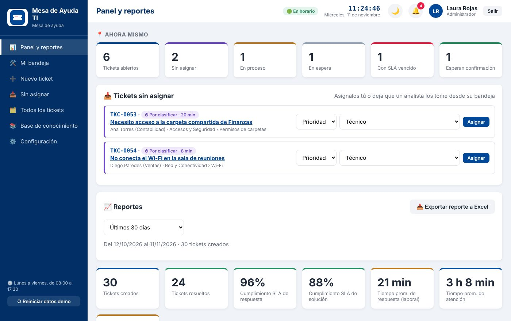
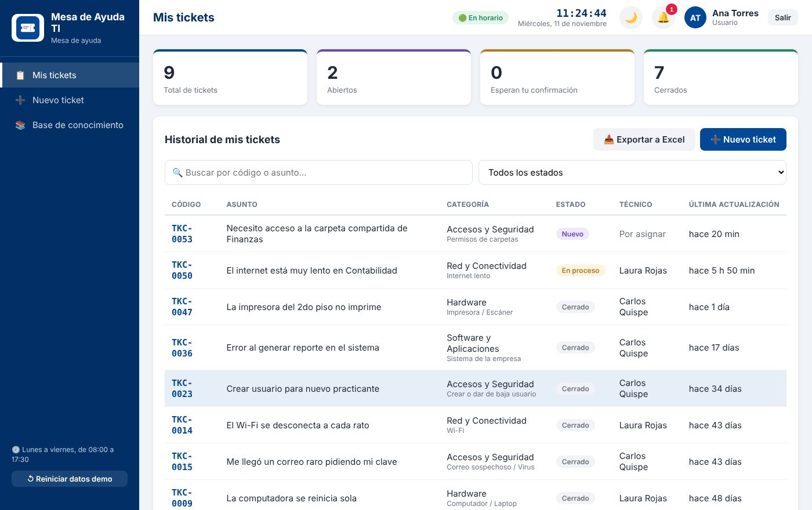
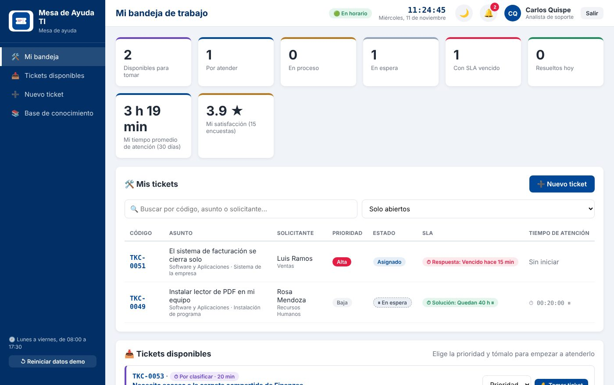
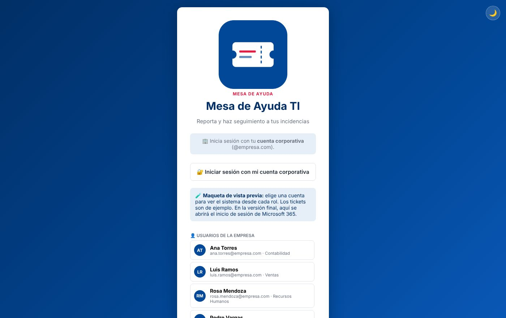

# Mesa de Ayuda TI

Sistema de tickets para el área de TI de una empresa: los colaboradores reportan sus problemas, los analistas los atienden con prioridades y tiempos de respuesta (SLA), y el administrador ve todo en un panel con reportes.

Hecho en **Python + Flask** con base de datos **SQLite**, listo para correr en **Docker** dentro de un servidor o un **NAS QNAP**.

🔗 **Demo en vivo (maqueta con datos de ejemplo):** https://carloscahuana12.github.io/mesa-de-ayuda-ti/

> En la demo toca **"Iniciar sesión con mi cuenta corporativa"** y elige un usuario: un colaborador (Ana Torres), un analista (Carlos Quispe) o el administrador (Laura Rojas). Todo es ficticio y se guarda solo en tu navegador.



## Qué hace

| Rol | Puede |
|---|---|
| **Colaborador** | Crear tickets con categoría y adjuntos, ver su avance, conversar con TI y calificar la atención. |
| **Analista** | Tomar tickets, cambiar estado y prioridad, responder, dejar notas internas y cerrar con solución. |
| **Administrador** | Asignar tickets, ver el panel con indicadores, exportar reportes a Excel, gestionar usuarios y categorías. |

- **SLA por prioridad** con horario laboral y feriados: el sistema avisa cuando un ticket está por vencer.
- **Cierre automático** de tickets resueltos sin respuesta en 48 horas.
- **Base de conocimiento** con soluciones frecuentes.
- **Importación masiva de trabajadores desde Excel**, con vista previa y contraseñas temporales.
- **Primer ingreso guiado**: crea la cuenta de administrador desde el navegador.
- **Se adapta al celular** y tiene tema claro u oscuro.
- Preparado para **inicio de sesión con Microsoft 365** (Entra ID) y **avisos por correo** (SMTP).
- **Respaldo diario automático** de la base de datos.

## Capturas

| Colaborador | Analista |
|---|---|
|  |  |



## Tecnología

- **Backend:** Python 3.12, Flask, SQLite.
- **Frontend:** HTML, CSS y JavaScript sin frameworks.
- **Despliegue:** Docker y Docker Compose (incluye configuración para QNAP Container Station), o Windows con `instalar.bat`.
- **Pruebas:** `pruebas.py` con 101 verificaciones automáticas (permisos, SLA, feriados, importación, cierre automático).

## Estructura

```
app.py            Rutas de la API y páginas
logica.py         Reglas del negocio (SLA, estados, prioridades)
basedatos.py      Tablas y migraciones de SQLite
config.py         Configuración desde el archivo .env
correo.py         Envío de avisos por correo
pruebas.py        Pruebas automáticas
web/              Interfaz (HTML, CSS, JS)
docs/             Maqueta estática publicada en GitHub Pages
```

## Probarlo en tu computadora

```bash
pip install -r requirements.txt
cp .env.ejemplo .env      # completa los datos
python servidor.py        # abre http://localhost:8080
python pruebas.py         # corre las pruebas
```

Con Docker:

```bash
docker compose up -d
```

La guía detallada de instalación está en [LEEME.md](LEEME.md), [INSTALAR-EN-NAS.md](INSTALAR-EN-NAS.md) e [INSTALAR-EN-QNAP.md](INSTALAR-EN-QNAP.md).

## Seguridad

- Las contraseñas se guardan cifradas (hash), nunca en texto plano.
- El archivo `.env`, la base de datos y los respaldos están excluidos del repositorio (`.gitignore`).
- Permisos por rol en cada ruta de la API.

## Autor

**Carlos Augusto Quispe Cahuana** · Analista de Soporte TI · Lima, Perú
[LinkedIn](https://www.linkedin.com/in/carlos-augusto-quispe-cahuana-0872b22b3)
